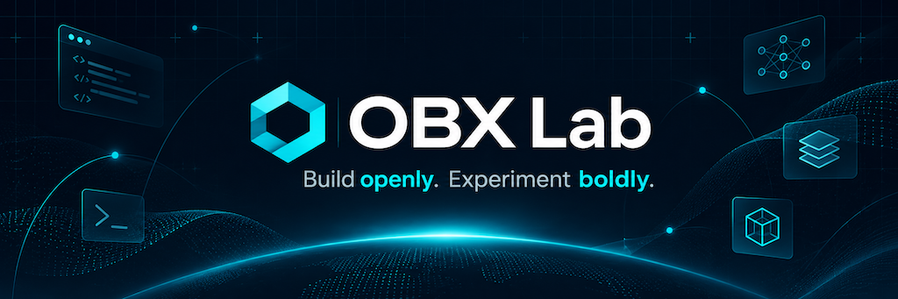

  

# OBX Lab

### Build openly. Experiment boldly.

**OBX Lab** is an independent software lab exploring ideas, building useful products, and turning experiments into real-world technology.

We believe great products begin with curiosity, grow through experimentation, and improve through open collaboration.

### What we build

- **AI & Intelligent Systems** — Agents, automation, intelligent workflows, and practical AI applications.
- **Developer Tools** — Libraries, frameworks, utilities, and tools that make engineering better.
- **Experimental Products** — Exploring new interfaces, unconventional ideas, and emerging technologies.
- **Open-Source Software** — Reusable components and projects built for the developer community.
- **Apps & Experiences** — Web, mobile, and desktop applications designed around real problems.

### Our philosophy

**Explore → Build → Learn → Share → Repeat**

We prefer working prototypes over endless presentations, simple solutions over unnecessary complexity, and learning through shipping.

Not every experiment will become a product. Every experiment should teach us something.

### Explore our work

Our repositories will include experiments, open-source libraries, developer utilities, and evolving products.

Projects will be shared as they become available.

### Build with us

Interested in experimenting, contributing, or exchanging ideas?

Explore our repositories, open an issue, suggest improvements, or start a discussion.

---

**OBX Lab** — From curiosity to code. From experiments to products.
